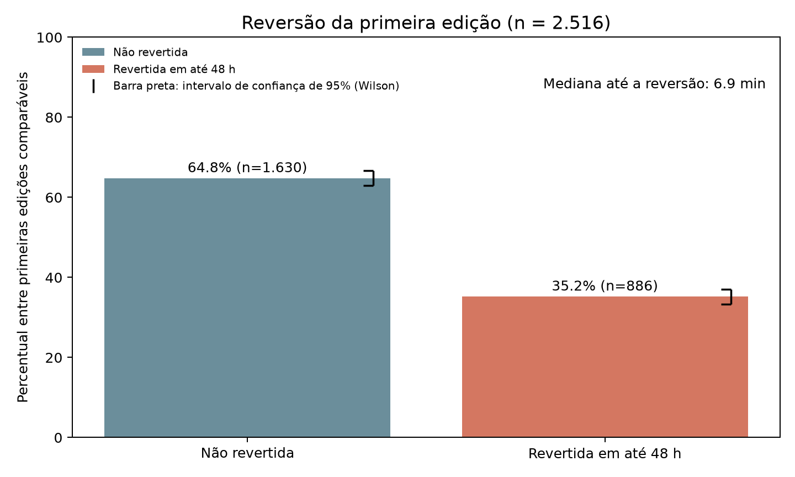
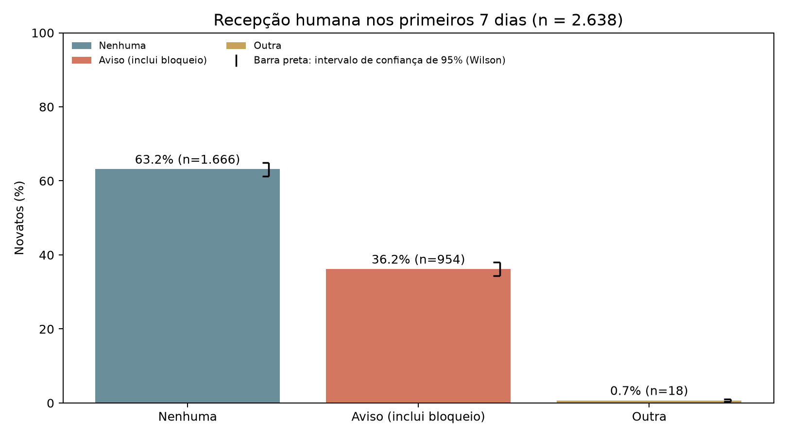
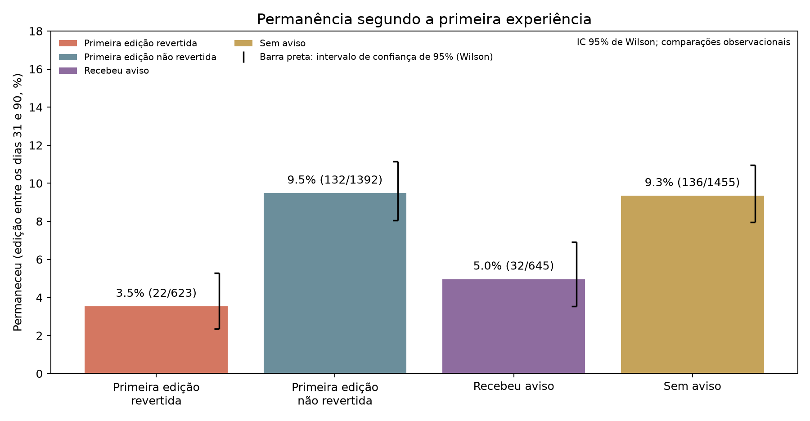

# Análise do projeto: recepção de novatos na Wikipédia em português

## Escopo e estado das etapas

Este relatório aplica as etapas 3 e 4 do [passo a passo](./Passo%20a%20passo%20para%20concluir%20o%20projeto.pdf) ao desenho do [pitch](./Pitch_Computação_Social.pdf), usando os CSVs existentes em `dados/`.

| Etapa | Preparado/feito no repositório | Ainda depende da equipe |
|---|---|---|
| 3 — base e amostra | Base de 2.638 novatos conferida; elegibilidade e comparabilidade calculadas; amostra balanceada de 200 casos; planilha de auditoria de 50 mensagens; gráficos e tabelas de análise gerados. | Revisar manualmente as 50 classificações de mensagens e, se necessário, corrigir os dados/fontes. |
| 4 — codificação qualitativa | Livro de códigos, planilha com links e campos para codificação, piloto de 30 casos e script para kappa preparados. | Dois integrantes codificarem independentemente o piloto; calcular e discutir kappa; concluir a codificação e selecionar exemplos anonimizados. |

As categorias qualitativas foram deixadas em branco intencionalmente: os CSVs não contêm o texto integral das mensagens e a codificação de intenção, explicação e tom exige leitura humana contextual. Portanto, ainda não há resultados qualitativos nem kappa calculável.

## Dados e definições

Os resultados vêm de `dados/base.csv`, `dados/coorte.csv`, `dados/novatos.csv` e `dados/reversoes.csv`. A análise de permanência segue as definições operacionais já adotadas no projeto: ao menos uma edição visível entre o 31º e o 90º dia após a criação da conta; exclusão de contas bloqueadas nos primeiros 30 dias e de contas cuja primeira edição em artigo ocorreu mais de sete dias após a criação.

Isso mantém a definição reprodutível da base e do [arquivo de definições](./definicoes.md). O pitch descrevia a janela de permanência a partir da primeira edição; aqui foi usada a definição operacional existente, a partir da criação da conta. Essa diferença deve ser mencionada na metodologia final.

O universo é de contas criadas em março de 2025, não março a maio como no desenho inicial do pitch. Os bloqueios globais, edições apagadas e páginas com revisões indisponíveis também limitam a cobertura. “Aviso” na análise inclui mensagens classificadas como aviso ou bloqueio; boas-vindas automáticas não contam como contato humano.

Há uma divergência no resumo preliminar do passo a passo: ele usa 2.552 como denominador de reversões comparáveis, mas esse total inclui 36 autorreversões. Como as definições operacionais excluem autorreversões, a base e os scripts usam 2.516 casos comparáveis (886 revertidos + 1.630 não revertidos); a taxa correspondente é 35,2%. Essa correção também foi registrada em [notas_coleta.md](./notas_coleta.md).

## Resultados quantitativos preliminares

### Funil

Conforme o registro da coleta em [notas_coleta.md](./notas_coleta.md), foram observados 13.696 registros de criação; 8.677 contas compuseram a coorte após excluir autocriadas e registros ocultos; 3.591 tiveram ao menos uma edição; 2.638 tiveram edição visível em artigo. Na base de estudo, 2.100 satisfazem os critérios de análise de permanência e 2.015 também têm uma primeira edição comparável por SHA1 (revertida ou não revertida).

Na base elegível, 168 de 2.100 novatos (8,0%) editaram entre os dias 31 e 90. Entre os 2.015 com primeira edição comparável, foram 154 (7,6%).

### P1 — primeira experiência e mensagens

- Entre 2.516 primeiras edições comparáveis em toda a base — excluídas autorreversões, páginas novas e revisões indisponíveis —, 886 (35,2%; IC95% 33,4–37,1%) foram revertidas em até 48 horas. A mediana até a reversão foi de 6,9 minutos; 78,7% (IC95% 75,8–81,2%) ocorreram na primeira hora.
- Das 886 reversões, 505 (57,0%) foram atribuídas a humanos e 381 (43,0%) a ferramentas semiautomáticas; nenhuma foi atribuída a robô.
- Na primeira semana, 1.666 de 2.638 novatos (63,2%; IC95% 61,3–65,0%) não tiveram contato humano classificado; 954 (36,2%; IC95% 34,4–38,0%) receberam aviso ou bloqueio e 18 (0,7%; IC95% 0,4–1,1%) receberam outra mensagem. Houve uma mensagem humana de boas-vindas, mas nenhum novato teve essa categoria como recepção semanal. A mensagem automática de boas-vindas foi excluída.

Os dados de reversão e mensagens acima são descritivos da coorte completa; não representam, por si sós, o efeito dessas experiências sobre permanência.

### P3 — associação com permanência

Na análise elegível, a permanência foi de 22/623 (3,5%; IC95% 2,3–5,3%) entre os que tiveram a primeira edição revertida e 132/1.392 (9,5%; IC95% 8,1–11,1%) entre os que não tiveram reversão comparável. A diferença é estatisticamente associada no teste qui-quadrado com correção de Yates, χ²(1)=20,76, p<0,001. No modelo logístico ajustado, reversão teve OR=0,47 (IC95% 0,26–0,86; p=0,014), controlando atividade de edição nas primeiras 24 horas, semana de criação e aviso recebido.

Considerando todos os elegíveis, permaneceram 32/645 (5,0%; IC95% 3,5–6,9%) dos que receberam aviso/bloqueio na primeira semana e 136/1.455 (9,3%; IC95% 8,0–11,0%) dos que não receberam. A associação bruta foi χ²(1)=11,09, p<0,001; no modelo logístico global, OR=0,45 (IC95% 0,30–0,67; p<0,001), com controles para atividade inicial, criação de artigo novo e semana de criação.

Entretanto, aviso e reversão ocorrem juntos com frequência. Na comparação mais específica entre os 623 elegíveis cuja primeira edição foi revertida, permaneceram 19/500 (3,8%) dos que receberam aviso/bloqueio e 3/123 (2,4%) dos que não receberam. A associação não foi estatisticamente detectável (χ²(1)=0,21, p=0,646); no modelo ajustado dentro desse grupo, OR=1,12 (IC95% 0,31–3,98; p=0,864). O intervalo é amplo e há poucos casos de permanência nesse estrato. Portanto, o resultado global para avisos não deve ser interpretado como efeito independente do aviso nem como evidência de causalidade.

Os testes e modelos são exploratórios, sem correção para múltiplas comparações. O estudo é observacional; p-valores não demonstram que a recepção causou permanência ou saída.

### Gráficos gerados







## Etapa 3 — base, verificações e arquivos

O script existente `scripts/montar_base.py` define uma linha por novato, o resultado de permanência e os critérios de inclusão. O novo [preparar_codificacao.py](./scripts/preparar_codificacao.py) verifica colunas e IDs únicos, existência da primeira edição, coerência temporal, grupos comparáveis e totais; então exporta a amostra e a auditoria.

Foram conferidos os totais: 2.638 linhas na base, 2.100 elegíveis e 2.015 elegíveis comparáveis. A amostra tem exatamente 100 primeiras edições revertidas e 100 não revertidas, sorteadas com semente 42; 30 casos foram separados para o piloto duplo. Os 170 restantes foram distribuídos entre quatro campos de codificador, com divisão equilibrada.

Arquivos criados:

- `dados/subamostra_codificacao.csv`: códigos de caso, status de reversão, sumários e links para a primeira edição, histórico da página, discussão e mensagens da semana; colunas em branco para cada codificação.
- `dados/piloto_codificador_1.csv` e `dados/piloto_codificador_2.csv`: os mesmos 30 casos do piloto em arquivos separados, para que os integrantes codifiquem sem ver as respostas um do outro.
- `dados/auditoria_classificacao_mensagens.csv`: 50 mensagens sorteadas com a classificação automática, link da revisão e campos para revisão manual.
- `dados/resultados_quantitativos.csv`: proporções e intervalos de confiança de 95% de Wilson.
- `dados/testes_associacao.csv`: tabelas e testes qui-quadrado.
- `dados/modelos_logisticos.csv`: odds ratios, intervalos de confiança e p-valores dos modelos.

Por ser uma amostra estratificada 1:1, os 200 casos não representam a prevalência populacional de reversões. A amostra serve à codificação qualitativa; estimativas descritivas devem vir da base completa.

## Etapa 4 — livro de códigos qualitativo

Use os links da planilha para ler o diff da primeira edição, o histórico da página, a revisão de reversão (quando existente) e as mensagens humanas válidas na primeira semana. Não deduza intenção apenas pelo fato de uma edição ter sido revertida. Em caso de evidência insuficiente, use “indeterminada” ou “incerta”, em vez de forçar uma categoria.

Os exemplos abaixo são **hipotéticos**, apenas para ilustrar as regras; não são achados nem citações de usuários.

### 1. `boa_fe`

Codifica a intenção aparente da primeira edição, considerando seu conteúdo e contexto.

- `boa_fe`: contribuição plausível para melhorar o artigo, acrescentar informação ou corrigir conteúdo, sem sinais claros de abuso. Exemplo hipotético: acrescenta uma informação pertinente e uma fonte verificável.
- `ma_fe`: vandalismo explícito, spam, propaganda ou conteúdo evidentemente abusivo. Exemplo hipotético: substitui deliberadamente o artigo por insultos.
- `indeterminada`: contexto ou conteúdo insuficiente para inferir intenção. Contraexemplo: não classificar automaticamente como má-fé só porque houve reversão.

### 2. `explicacao_reversao`

Codifica a justificativa registrada para a reversão da primeira edição. Leia o sumário e confira o diff/contexto quando o sumário não for suficiente.

- `especifica`: identifica o problema ou a regra aplicável de modo compreensível. Exemplo hipotético: explica que a informação não tem fonte e aponta o trecho.
- `generica`: indica apenas que a edição foi desfeita, sem explicar o motivo. Exemplo hipotético: “revertendo edição”.
- `ausente`: não há justificativa textual útil disponível.
- `incerta`: sumário ou revisão não permitem decidir entre as categorias.
- `nao_aplicavel`: primeira edição não foi revertida.

### 3. `tom_mensagem`

Codifica o tom da primeira mensagem humana válida na semana; exclua a mensagem automática, mensagens de manutenção e mensagens desfeitas. Se houver várias, registre a primeira e anote mensagens adicionais relevantes em `observacao`.

- `acolhedor_construtivo`: reconhece ou incentiva a participação e orienta de forma respeitosa. Exemplo hipotético: agradece a contribuição e sugere como adicionar fontes.
- `neutro_informativo`: comunica uma regra ou instrução sem acolhimento ou hostilidade marcantes. Exemplo hipotético: informa o procedimento para contestar uma remoção.
- `repreensivo_punitivo`: acusa, ameaça ou repreende de forma hostil ou predominantemente punitiva. Exemplo hipotético: chama o novato de vândalo sem orientação.
- `misto_ou_incerto`: combina tons ou não oferece evidência suficiente.
- `sem_mensagem`: não houve mensagem humana válida na semana.

### Piloto, concordância e exemplos para o artigo

Dois integrantes devem preencher independentemente os arquivos `piloto_codificador_1.csv` e `piloto_codificador_2.csv`, cada qual sem acesso às respostas do outro e sem conversar antes de concluir. Depois, executar:

```bash
.venv/bin/python -m scripts.avaliar_codificacao
```

O script combina os arquivos pelo código do caso e calcula kappa de Cohen separadamente para boa-fé, explicação da reversão e tom da mensagem, usando somente pares completos. Com kappa abaixo de 0,7, discutam as divergências, revisem o livro e codifiquem um novo piloto independente antes de avançar. A saída atual informa que o kappa ainda não é calculável, pois os campos estão vazios. O preparador também impede sobrescrever planilhas que já contenham codificação manual.

Após o piloto, distribuam os casos restantes conforme `codificador_responsavel`. Selecionem exemplos de cada categoria apenas depois da codificação, parafraseiem-nos e removam nomes, IDs e detalhes que permitam identificar pessoas. Não publiquem mensagens integrais nem nomes de usuários no artigo.

## Como reproduzir

O ambiente `.venv` está na raiz e as bibliotecas de análise foram acrescentadas ao [requirements.txt](./requirements.txt). Para recriar as saídas de análise e amostragem:

```bash
.venv/bin/python -m scripts.preparar_codificacao
.venv/bin/python -m scripts.gerar_graficos
.venv/bin/python -m scripts.avaliar_codificacao
```

O último comando só produzirá valores de kappa depois que a planilha tiver as codificações independentes do piloto.
