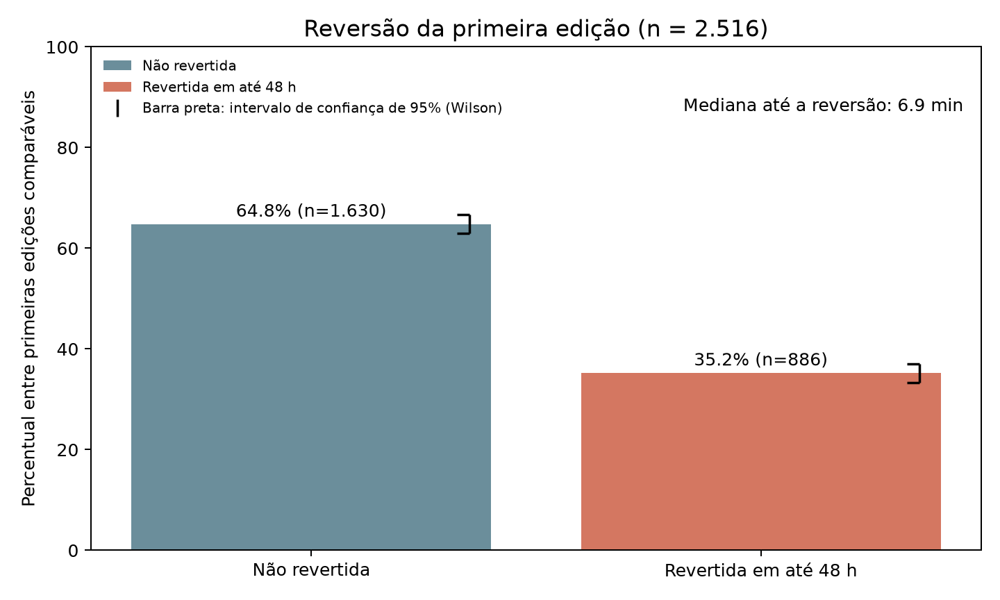
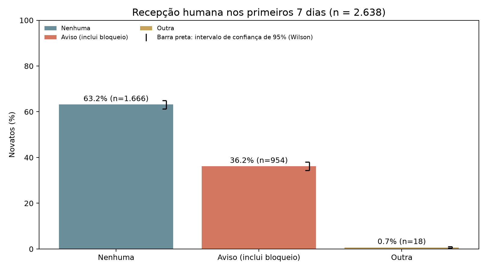
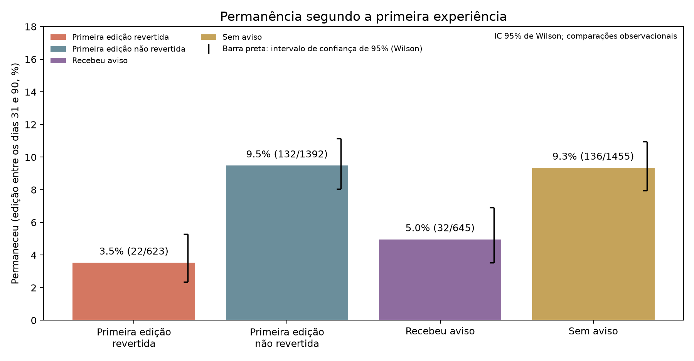
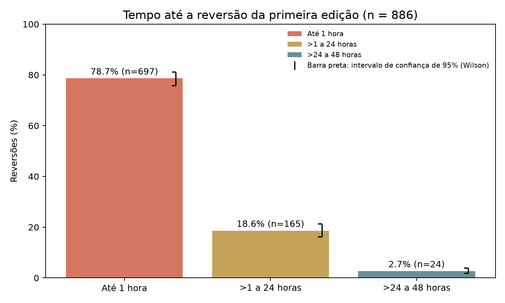
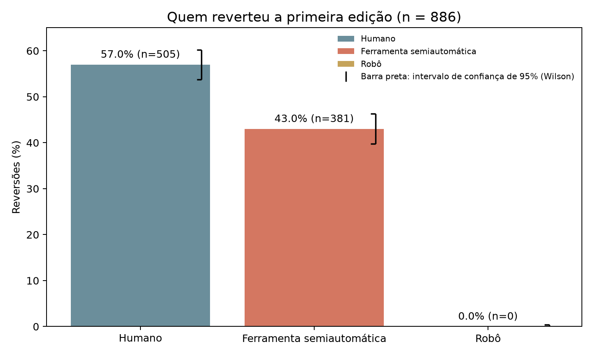

# Etapa 5 — resultados para análise e apresentação

Este documento consolida as respostas quantitativas às perguntas do projeto, as figuras geradas e as ressalvas que devem acompanhar os resultados. Os valores podem ser reproduzidos no notebook [analise_etapa5.ipynb](./analise_etapa5.ipynb) ou com `.venv/bin/python -m scripts.gerar_graficos`.

## Resultados principais

### QP1 — Como os novatos são recebidos e como é sua primeira experiência?

O universo analisado contém contas criadas em março de 2025. Foram 8.677 contas na coorte, 3.591 com ao menos uma edição e 2.638 com edição visível em artigo. A análise de permanência inclui 2.100 novatos; 2.015 também têm uma primeira edição comparável por SHA1.

Entre 2.516 primeiras edições comparáveis na coorte completa, 886 (35,2%; IC95% 33,4–37,1%) foram revertidas em até 48 horas. A mediana até a reversão foi de 6,9 minutos. Das 886 reversões, 697 (78,7%) ocorreram em até uma hora, 165 (18,6%) entre uma e 24 horas e 24 (2,7%) entre 24 e 48 horas.

Na primeira semana, 1.666 de 2.638 novatos (63,2%; IC95% 61,3–65,0%) não tiveram contato humano classificado; 954 (36,2%; IC95% 34,4–38,0%) receberam aviso (categoria que inclui bloqueio); e 18 (0,7%; IC95% 0,4–1,1%) receberam outra mensagem. Boas-vindas automáticas foram excluídas. A categoria foi atribuída por palavras-chave no sumário da edição da mensagem. Portanto, “recebeu aviso” não identifica um aviso específico, o motivo dele, nem garante que tenha sido uma advertência formal.

**Leitura para a apresentação:** aproximadamente um terço das primeiras edições comparáveis foi revertido rapidamente; quase dois terços dos novatos não tiveram contato humano classificado na primeira semana. Esses valores descrevem a coorte, não demonstram por si só que uma experiência causou abandono.

### QP2 — Quem reverte e que justificativa fica registrada?

Das 886 reversões, 505 (57,0%; IC95% 53,7–60,2%) foram atribuídas a humanos e 381 (43,0%; IC95% 39,8–46,3%) a ferramentas semiautomáticas; nenhuma foi atribuída a robôs. Em 882 casos (99,5%) havia sumário de edição. A presença de um sumário não informa se a justificativa era específica, correta ou respeitosa; essa qualidade exige leitura e codificação contextual.

O piloto consensual de 30 casos contém 7 justificativas classificadas como específicas, 9 genéricas, 2 incertas e 12 não aplicáveis (primeira edição não revertida). Esses números descrevem apenas o piloto discutido pelo grupo, não as 886 reversões. Não calcular kappa: os casos foram discutidos conjuntamente, não codificados de forma independente.

### QP3 — Há associação entre recepção e permanência?

A permanência operacional é ao menos uma edição visível entre o 31º e o 90º dia após a criação da conta.

- Entre os 623 elegíveis com primeira edição revertida, 22 (3,5%; IC95% 2,3–5,3%) permaneceram; entre os 1.392 sem reversão comparável, 132 (9,5%; IC95% 8,1–11,1%) permaneceram. A associação bruta foi χ²(1)=20,76, p<0,001. No modelo ajustado, OR=0,47 (IC95% 0,26–0,86; p=0,014).
- Entre os 645 elegíveis com aviso/bloqueio, 32 (5,0%; IC95% 3,5–6,9%) permaneceram; entre os 1.455 sem aviso/bloqueio, 136 (9,3%; IC95% 8,0–11,0%) permaneceram. A associação bruta foi χ²(1)=11,09, p<0,001; no modelo global ajustado, OR=0,45 (IC95% 0,30–0,67; p<0,001).
- Restringindo a análise aos 623 revertidos, permaneceram 19/500 (3,8%) dos que receberam aviso/bloqueio e 3/123 (2,4%) dos que não receberam. A associação não foi estatisticamente detectável (χ²(1)=0,21, p=0,646; OR ajustado=1,12; IC95% 0,31–3,98; p=0,864). O intervalo é amplo e há poucos eventos nesse estrato.

Os resultados são associações observacionais, não efeitos causais. Aviso e reversão podem ocorrer juntos, e os resultados ajustados dependem das variáveis incluídas nos modelos. Não foi feita análise de permanência restrita a novatos de boa-fé: somente os 30 casos do piloto têm codificação, insuficiente para estimar esse subgrupo na amostra.

## Figuras recomendadas

Priorize os três primeiros gráficos para os slides principais. Os dois últimos são material de apoio para explicar a rapidez das reversões e a participação de humanos/ferramentas.

### 1. Reversões da primeira edição

**Mensagem do slide:** 886 de 2.516 (35,2%) foram revertidas em até 48 horas. Denominador: primeiras edições comparáveis; exclui autorreversões, páginas novas e revisões indisponíveis.

### 2. Recepção na primeira semana

**Mensagem do slide:** 36,2% receberam aviso (categoria que inclui bloqueio); 63,2% não tiveram contato humano classificado. A classificação usa palavras-chave no sumário da edição da mensagem e não identifica um motivo específico. Boas-vindas automáticas são excluídas.

### 3. Permanência por experiência

**Mensagem do slide:** as taxas observadas de permanência são menores para o grupo revertido e para o grupo com aviso/bloqueio. O gráfico representa associações, não causalidade; apresentar junto com a janela de permanência (dias 31–90).

### 4. Tempo até a reversão

**Mensagem de apoio:** 78,7% das reversões ocorreram em até uma hora; mediana de 6,9 minutos.

### 5. Tipo de revertor

**Mensagem de apoio:** 57,0% das reversões foram feitas por humanos e 43,0% por ferramentas semiautomáticas.

## Roteiro enxuto de apresentação

1. **Coorte e método:** contas criadas em março de 2025; explique as exclusões e a definição de permanência.
2. **Primeira experiência:** taxa e rapidez das reversões (gráficos 1 e, se couber, 4).
3. **Recepção:** categorias de contato humano e definição operacional de aviso (gráfico 2).
4. **Quem reverte:** humanos e ferramentas; deixe claro que sumário presente não mede qualidade (gráfico 5).
5. **Permanência:** diferenças observadas, teste/modelo e comparação dentro do grupo revertido (gráfico 3).
6. **Limitações e próximos passos:** associação não é causalidade; piloto qualitativo é consenso de 30 casos e não representa a coorte; a codificação completa ainda é necessária para responder sobre boa-fé.

## Comparação com Halfaker et al. (2013)

O estudo de Halfaker et al. relaciona mecanismos mais restritivos de controle de qualidade à queda da retenção de novatos na Wikipédia em inglês. A comparação aqui deve ser conceitual, não uma comparação direta de percentuais: idioma, período, população, definição de primeira experiência, janela de permanência e critérios de inclusão são diferentes. Não apresentar a taxa de 18,2% mencionada nas notas como se tivesse o mesmo denominador ou definição deste estudo sem harmonizar as medidas.

Referência: Halfaker, A. et al. (2013). “The Rise and Decline of an Open Collaboration System”. *American Behavioral Scientist*, 57(5), 664–688. [https://doi.org/10.1177/0002764212469365](https://doi.org/10.1177/0002764212469365).

## Reprodutibilidade e limites da codificação

- Execute `analise_etapa5.ipynb` para validar contagens, consultar tabelas e visualizar os gráficos; o notebook recria os CSVs e PNGs por meio do script.
- Execute `.venv/bin/python -m scripts.gerar_graficos` para recriar apenas os resultados quantitativos e gráficos.
- A codificação em `dados/piloto_codificador_1.csv` foi decidida em discussão coletiva. `dados/piloto_codificador_2.csv` não é usado nesta análise. Não calcular ou reportar kappa como concordância independente.
- Os 30 casos do piloto não substituem a codificação dos 200 casos da subamostra e não sustentam estimativas para todos os novatos.
- Os testes e modelos são exploratórios, sem correção para múltiplas comparações. Resultados não demonstram causalidade.
